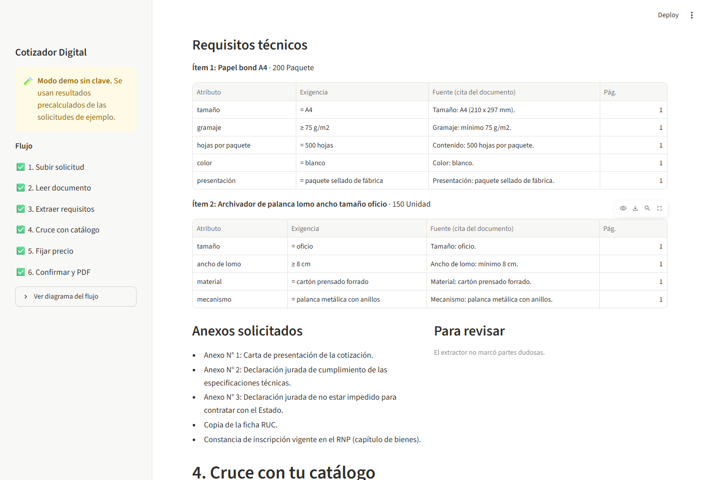
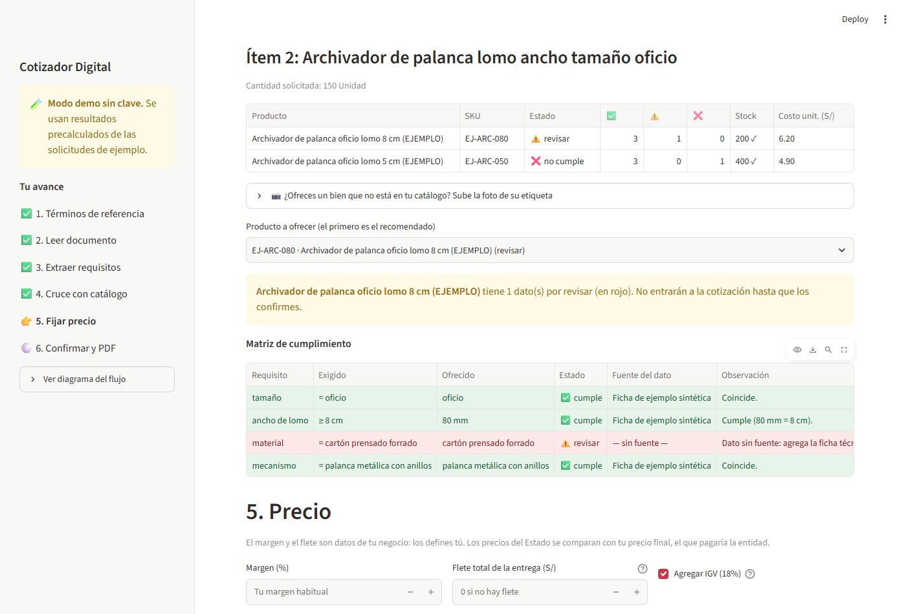
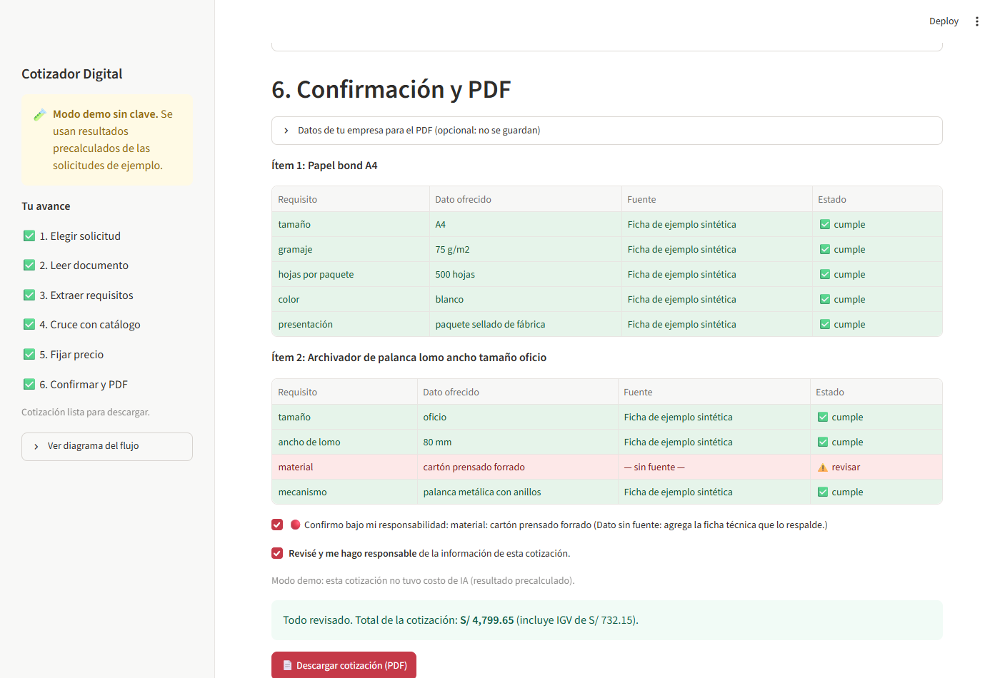
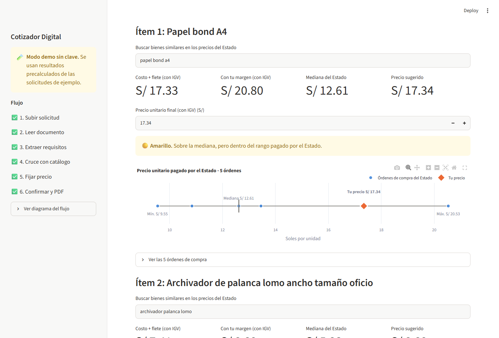
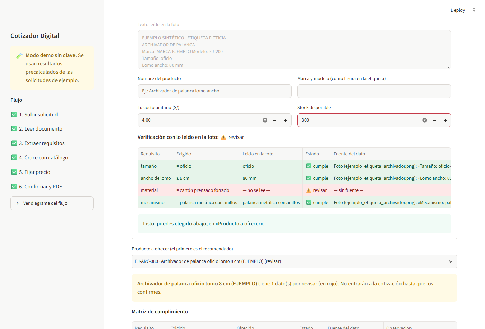
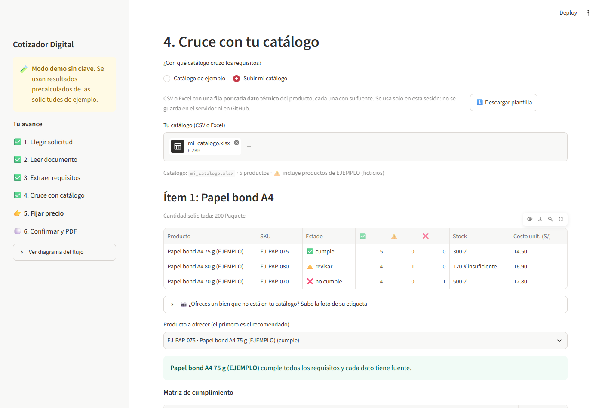
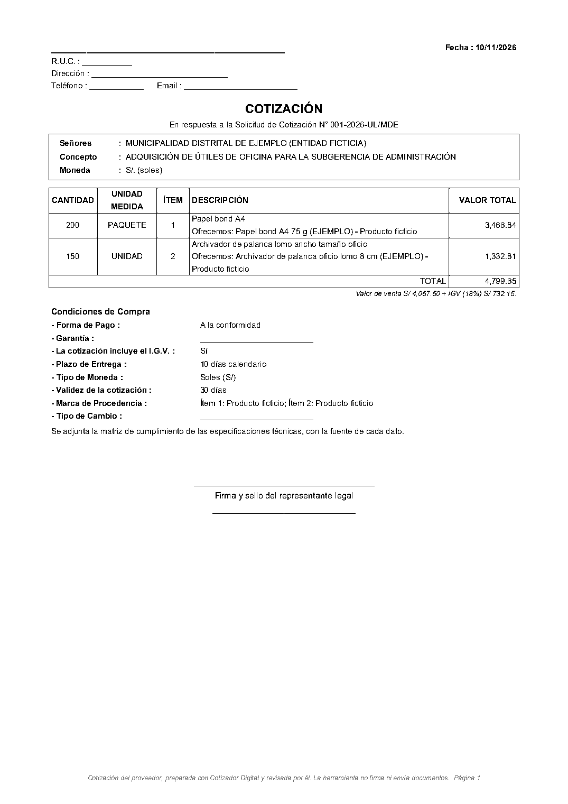
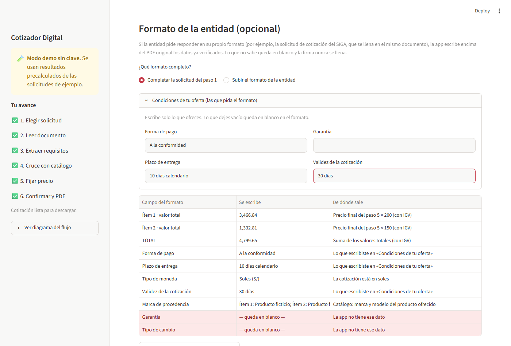
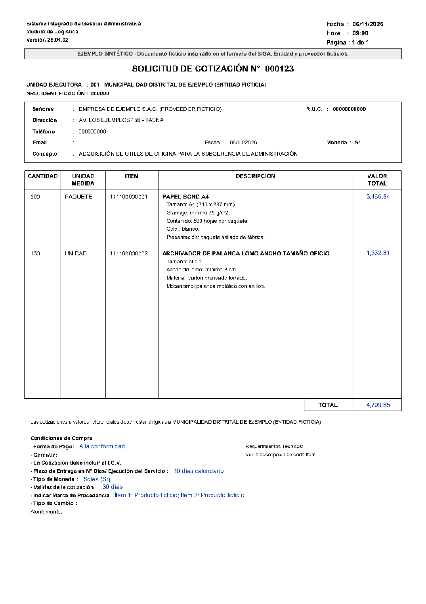
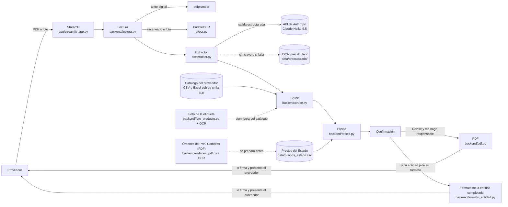

# Cotizador Digital

> **Preparamos cotizaciones listas para firmar para mypes proveedoras del Estado peruano, mediante IA que lee los términos de referencia, verifica cada requisito contra el catálogo del proveedor, con la fuente de cada dato, y compara el precio con lo que pagó el Estado.**

Proyecto final de la Diplomatura en Ciencia de Datos (Q-Lab PUCP). Demo de un solo flujo, para bienes: de los términos de referencia a la cotización lista para firmar.

**Regla de oro:** ningún dato técnico entra a la cotización sin una fuente. Lo que no está verificado se marca en rojo y el PDF no se genera hasta que el proveedor lo revise y confirme. **La herramienta nunca firma ni envía nada.**

---

## 1. One-liner

Preparamos cotizaciones listas para firmar para mypes proveedoras del Estado peruano, mediante IA que lee los términos de referencia, verifica cada requisito contra el catálogo del proveedor, con la fuente de cada dato, y compara el precio con lo que pagó el Estado.

## 2. Founder

**Ivette Mamani Flores**: contadora pública y administradora de contratos en el sector público, en Tacna. Conoce el proceso desde el lado de la entidad: cómo se arma una solicitud de cotización, qué se revisa al recibir las propuestas y por qué una cotización incompleta queda fuera. Construye la startup sola, con un agente de IA como co-founder técnico (ver la parte 9).

> ✍️ **Pendiente (Ivette):** en dos o tres líneas, por qué tú y por qué ahora; por ejemplo, qué viste en tu trabajo que te llevó a esta idea.

## 3. Problema

Las unidades de logística de las entidades públicas envían **solicitudes de cotización** a pequeños proveedores para sus contrataciones menores (hasta 8 UIT). Para responder cada una, el proveedor tiene que:

1. leer los términos de referencia o las especificaciones técnicas;
2. ver si su producto cumple, requisito por requisito;
3. buscar la ficha técnica que lo respalde;
4. calcular un precio competitivo;
5. llenar la carta y los anexos.

Todo se hace a mano: una de las proveedoras entrevistadas imprime la solicitud, la llena, la firma, la escanea y la envía. Con experiencia, eso toma de 10 a 30 minutos. **Lo difícil es ganar la orden:** gana el menor precio, y una especificación que no coincide exactamente descarta la oferta, incluso después de adjudicada.

### Lo que escuchamos

Dos conversaciones grabadas con proveedores del Estado (resúmenes sin datos personales en [`docs/research/`](docs/research/)):

| | Mype ferretera (Tacna) | Imprenta familiar |
|---|---|---|
| Vende al Estado | Hace 8 años | Desde 2004 |
| Solicitudes que recibe | Unas 10 al día, por correo | Por correo y WhatsApp; no dio una cifra |
| Tiempo por cotización | 10 a 30 min; de 1 a 2 horas, o hasta el día siguiente, si el producto no es común | 15 a 30 min |
| Cuántas gana | 3 a 5 de cada 10 que responde | Gana el menor precio |
| Cuáles no responde | Pocas: las de otro rubro o de fuera de Tacna | Las de entidades sin presupuesto, por el riesgo de no cobrar |
| Perdió una orden por una especificación | Sí: pidieron una medida de perno que no existe; ofreció la más cercana y no le adjudicaron | Sí: le rechazaron un bien ya adjudicado que no coincidía con las especificaciones |
| Cómo pone el precio | Distancia, cantidad, dólar, flete y plazo de pago de la entidad | Por experiencia; una agenda bajó de S/ 8 a S/ 6 en cuatro años |

> «Las entidades ahora son un poquito más especiales, siempre te piden fichas técnicas.» Dueña de una mype ferretera.
>
> «Claro que sí, sería una suerte para nosotros.» Dueño de una imprenta, ante la idea de ver lo que pagó el Estado por cada bien.

> ✍️ **Pendiente (Ivette):** la tercera conversación, con la pregunta de cuánto pagaría al mes, que todavía no se ha hecho; y verificar en el audio las cifras marcadas con ✍️ en `docs/research/`.

## 4. Solución e insight

**Solución:** una app que en minutos convierte la solicitud en una cotización lista para revisar y firmar.

| Paso | Qué hace | Cómo |
|---|---|---|
| 1. Subir | Los **términos de referencia** (TDR) de la entidad: PDF digital, PDF escaneado o foto | Streamlit |
| 2. Leer | Extrae el texto, página por página | pdfplumber; PaddleOCR si la página es imagen |
| 3. Extraer | Entidad, objeto, ítems, requisitos técnicos (atributo, operador, valor, unidad), plazo, lugar, fecha límite y anexos, **con la cita y la página de cada requisito** | LLM con salida estructurada + Pydantic |
| 4. Cruzar | Cada requisito contra el catálogo del proveedor, **que puede subir su propio catálogo** (CSV o Excel, con plantilla descargable): ✅ cumple, ⚠️ revisar o ❌ no cumple, con la fuente de cada dato. Ordena los productos por estado, stock y costo. **Si el bien no está en el catálogo**, el proveedor sube la foto de su etiqueta: el OCR lee lo impreso y se verifica igual, y lo que no se lee queda en rojo | pandas, PaddleOCR |
| 5. Precio | Costo + flete + margen, comparado con lo que pagó el Estado: mínimo, mediana, máximo y número de órdenes, precio sugerido y semáforo | plotly |
| 6. Confirmar | Cada dato en rojo se confirma uno por uno, más la casilla **"Revisé y me hago responsable"**. Recién entonces se descarga la **cotización del proveedor con la estructura de la solicitud de cotización del SIGA** (cantidad, unidad, ítem, descripción, valor total, TOTAL y condiciones de compra), con la matriz de cumplimiento. **Opcional:** si la entidad envió su solicitud SIGA, el proveedor la agrega y la cotización se entrega en ese mismo documento, completado encima del original | fpdf2, pypdf, PaddleOCR |

**Insight (de las conversaciones):** el proveedor con experiencia no tarda en llenar la cotización, entre 10 y 30 minutos. **Pierde la orden por el precio o por un detalle técnico que no coincide.** Los dos proveedores entrevistados perdieron una orden por una especificación, y los dos dicen que gana el menor precio. Por eso la app pone el peso en la matriz de cumplimiento, requisito por requisito y con la fuente de cada dato (paso 4), y en el precio comparado con lo que pagó el Estado (paso 5). La herramienta no "decide" por el proveedor: lo que no tiene fuente queda en rojo, y la responsabilidad final (revisar y firmar) sigue siendo suya.

> ✍️ **Pendiente (Ivette):** confirma o corrige este insight con la tercera conversación.

## 5. Why now

Hace tres años, a fines de 2023, esta herramienta no era viable para una mype. Tres cosas cambiaron:

| | Fines de 2023 | Hoy (noviembre de 2026) |
|---|---|---|
| **Pasar de un documento a datos estructurados** | La API de Claude no tenía uso de herramientas (llegó a todos el 30/05/2024) ni salida estructurada: había que pedir el JSON en el prompt y arreglar a mano lo que saliera mal. | **Salida estructurada** con esquema garantizado: beta desde el 14/11/2025 y para todos desde el 29/01/2026. `messages.parse()` devuelve un objeto Pydantic válido, con la cita y la página de cada requisito. |
| **Costo de la IA** | Sin salida estructurada, cada respuesta de la IA había que revisarla y corregirla a mano: el tiempo que se quería ahorrar se volvía a gastar. | **Claude Haiku 5.5** (lanzado el 07/10/2026) cuesta US$ 0,10 por millón de tokens de entrada y US$ 0,50 de salida: **la décima parte** de lo que cuesta Claude Haiku 4.5 (US$ 1 y US$ 5), lanzado apenas en octubre de 2025. |
| **Precios de referencia del Estado** | Perú Compras ya publicaba sus órdenes de compra (diccionario de datos de 2018, estándar OCDS desde 2020), pero el precio de cada producto está en un PDF escaneado: compararlos a mano no escala. | El OCR combinado con reglas que verifican los montos convierte esos PDF en precios por producto (95 precios de 18 órdenes en este proyecto, ver [Datos y fuentes](#datos-y-fuentes)). |

El OCR abierto ya existía en 2023 (PaddleOCR 2.7, septiembre de 2023). Lo nuevo es combinarlo con un modelo de lenguaje barato y con salida garantizada: la versión 3 de PaddleOCR (mayo de 2025), cuyos modelos PP-OCRv5 usa la app, lee una página escaneada en unos 6 segundos en una laptop sin tarjeta gráfica (medido en este proyecto). Además, el OECE gestiona hoy los contratos menores en una herramienta digital ([gob.pe: Gestionar Contratos Menores](https://www.gob.pe/70088-gestionar-contratos-menores)).

*Fuentes: [notas de versión de la API de Claude](https://platform.claude.com/docs/en/release-notes/overview), [precios de Claude](https://platform.claude.com/docs/en/about-claude/pricing), [historial de PaddleOCR en PyPI](https://pypi.org/project/paddleocr/#history) y el [diccionario de datos de Perú Compras](https://saeusceprod01.blob.core.windows.net/contproveedor/Documentos/Publico/Diccionario_de_Datos_Abiertos.pdf). Consultadas el 10/11/2026.*

## 6. Demo

**URL pública:** **https://cotizadordigital.streamlit.app** (Streamlit Community Cloud). Probada de principio a fin el 09/11/2026: PDF digital, foto con OCR, precios del Estado y descarga del PDF. Si nadie la usa por un tiempo se duerme; al abrirla tarda un poco en despertar.

La demo funciona **sin clave de API** (modo demo): usa el resultado precalculado de la solicitud de ejemplo y lo avisa en pantalla. Así la presentación no depende de internet.

### Capturas

| Requisitos extraídos, con la cita de cada uno | Cruce: el dato sin fuente queda en rojo | Confirmación y PDF |
|---|---|---|
|  |  |  |

**Tarjeta de precio con órdenes reales del Estado:** el papel bond A4 se compara con 5 órdenes de compra de Perú Compras (mayo a octubre de 2026).



**Un bien que no está en el catálogo, verificado con la foto de su etiqueta:** el OCR lee el tamaño, el lomo (80 mm = 8 cm) y el mecanismo; el material no está impreso y queda en rojo.



**El proveedor sube su propio catálogo** (CSV o Excel) o descarga la plantilla para armarlo:



**La cotización:** documento del proveedor con la estructura de la solicitud de cotización del SIGA, para que el evaluador lo lea como está acostumbrado. No lleva el encabezado del sistema ni datos que emite la entidad.



**Opcional, con la solicitud SIGA que envió la entidad:** el proveedor la agrega en el paso 6 y la cotización se entrega en ese mismo documento (aquí, una solicitud SIGA de EJEMPLO SINTÉTICO, escaneada). La app muestra qué escribirá y de dónde sale cada dato; los valores van en azul y lo que no indicó el proveedor queda en blanco.

| Vista previa en la app | Solicitud SIGA completada |
|---|---|
|  |  |

*Capturas con la solicitud de EJEMPLO SINTÉTICO, el catálogo de ejemplo y un margen y un flete ilustrativos. Los precios del Estado son reales.*

### Arquitectura



### Modelos y APIs, y por qué

| Pieza | Elección | Por qué |
|---|---|---|
| Extracción de requisitos | **Claude Haiku 5.5** (`claude-haiku-5-5`), API de Anthropic, con `messages.parse()` y un esquema Pydantic | Es el modelo vigente más económico (el costo por cotización es parte del modelo de negocio) y la salida estructurada devuelve JSON que siempre cumple el esquema. Se puede cambiar con la variable `ANTHROPIC_MODEL`. |
| OCR | **PaddleOCR**, modelos `PP-OCRv5_mobile_det` y `latin_PP-OCRv5_mobile_rec` | Es abierto, corre en CPU, lee tildes y ñ, y los modelos *mobile* caben en la memoria de un servidor gratuito. Se carga solo cuando hace falta. |
| PDF digital | **pdfplumber** | Si la página trae texto, no hace falta OCR: es instantáneo y exacto. |
| Datos de precios | **Perú Compras**: exportación de datos abiertos del buscador de órdenes + el PDF de una muestra de órdenes, leído con PaddleOCR | Es la fuente oficial de lo que pagó el Estado. La exportación trae solo el total de cada orden; el precio por producto está en el PDF. |

## 7. Modelo de negocio

**Quién paga:** la **mype proveedora del Estado**, con una suscripción mensual. La entidad pública no paga ni usa la herramienta: recibe la cotización firmada por el proveedor, como hoy.

| Plan | Precio | Qué incluye |
|---|---|---|
| **Primer proveedor gratis** | S/ 0 | 3 cotizaciones |
| **Básico** | S/ 79 al mes | ✍️ *pendiente* |
| **Pro** | S/ 179 al mes | ✍️ *pendiente* |

> ✍️ **Pendiente (Ivette):** qué incluye cada plan pagado (por ejemplo, cuántas cotizaciones al mes, cuántos productos en el catálogo y si incluye alertas cuando lleguen) y qué responden tus entrevistados sobre la disposición a pagar.

**Costo por usuario:**

| Componente | Costo | Cómo se obtiene |
|---|---|---|
| IA (tokens) | ✍️ *pendiente: US$ por cotización* | Cada llamada al LLM registra sus tokens en `logs/uso_llm.jsonl`; `python -m ai.costos` calcula el costo promedio por cotización. Se mide con las solicitudes reales y la clave de API. |
| OCR | S/ 0 | PaddleOCR corre dentro de la app, sin API de pago. |
| Servidor | S/ 0 en la demo | Streamlit Community Cloud es gratis. Hugging Face Spaces exige hoy la suscripción PRO (US$ 9 al mes) para apps como esta. |
| APIs de datos | S/ 0 | Los datos de Perú Compras son abiertos. |

Costo de IA al mes por usuario = costo por cotización × cotizaciones al mes.

## 8. Herramientas del curso

| Herramienta | Sesión | Dónde está |
|---|---|---|
| Scraping responsable | 03 | [`backend/descargar_ordenes.py`](backend/descargar_ordenes.py). Como último recurso: la exportación oficial (descargada a mano) no trae el precio por producto, así que se bajaron 50 PDF de órdenes con las 10 reglas. Detalle en [Datos y fuentes](#datos-y-fuentes). |
| LLM con salida estructurada | 08 | [`ai/extractor.py`](ai/extractor.py), [`ai/esquemas.py`](ai/esquemas.py), [`ai/prompts.py`](ai/prompts.py) |
| OCR | 10 | [`ai/ocr.py`](ai/ocr.py), [`backend/lectura.py`](backend/lectura.py) y [`backend/ordenes_pdf.py`](backend/ordenes_pdf.py) (órdenes de compra escaneadas) y [`backend/foto_producto.py`](backend/foto_producto.py) (etiqueta de un bien fuera del catálogo) |
| pandas | | [`backend/catalogo.py`](backend/catalogo.py), [`backend/cruce.py`](backend/cruce.py), [`backend/precios.py`](backend/precios.py), [`backend/ordenes_pdf.py`](backend/ordenes_pdf.py) |
| Visualización (plotly) | | [`backend/grafico_precio.py`](backend/grafico_precio.py) |
| App web (Streamlit) | | [`app/streamlit_app.py`](app/streamlit_app.py) |
| Validación (Pydantic) | | [`ai/esquemas.py`](ai/esquemas.py) |
| PDF (fpdf2, pypdf) | | [`backend/pdf.py`](backend/pdf.py) (cotización propia) y [`backend/formato_entidad.py`](backend/formato_entidad.py) (escribe sobre el formato de la entidad) |
| Pruebas (pytest) | | [`tests/`](tests/): 100 pruebas |
| Evaluación | 12 | Opcional, pendiente: medir qué porcentaje de requisitos se extrae bien en solicitudes revisadas a mano. |

## 9. Qué hizo el agente

El código lo escribió **Claude Code** (Claude Opus 5.5) como co-founder técnico, bloque por bloque, a partir del encargo de Ivette ([`docs/prompt_inicial.md`](docs/prompt_inicial.md)). Ivette aprobó cada bloque antes de pasar al siguiente. El registro completo de qué generó el agente y qué decidió Ivette está en [`docs/agente.md`](docs/agente.md).

En resumen:

- **Generó** todo el código, las 100 pruebas, la solicitud, el catálogo y la foto de ejemplo (sintéticos y marcados como tales), los precios reales del Estado (leídos de las órdenes de compra de Perú Compras), los archivos de despliegue y esta documentación.
- **Funciones que agregó después del plan inicial, a pedido de Ivette:** verificación de un bien fuera del catálogo con la foto de su etiqueta, subida del catálogo propio (CSV o Excel, con plantilla), una tabla de requisitos por ítem, la barra lateral con el avance del usuario y el llenado del formato de la entidad (solicitud SIGA) sobre el PDF original.
- **Resolvió en el camino:** el antivirus que interceptaba HTTPS (con `truststore`), un error de paddlepaddle 3.3 con oneDNN (se fijó la versión 3.2.2, cuatro veces más rápida), el cambio de Hugging Face Spaces a Streamlit Community Cloud cuando HF empezó a cobrar, que la exportación de datos abiertos de Perú Compras no traía el precio por producto (se leyeron los PDF de las órdenes con OCR, con autorización de Ivette y las reglas de scraping responsable) y un error de redondeo que dejaba el precio sugerido bajo el costo.
- **Transcribió y resumió** las conversaciones que grabó Ivette, en su laptop, sin enviar el audio a ningún servicio. En los resúmenes no hay nombres, y cada dato lleva el minuto de la grabación para verificarlo. Las grabaciones no están en el repositorio.
- **No inventó** especificaciones de productos reales, márgenes, fletes ni cifras del mercado: esos datos quedan como campos que llena el proveedor o como pendientes marcados con ✍️.
- **Ivette decidió** el problema, el flujo, la regla de oro, los planes, la plataforma de despliegue, qué entra o no en la demo y las funciones que se agregaron después (foto de producto, catálogo propio, tabla por ítem, barra de avance y formato de la entidad). Para el formato, aportó un documento real que se usó solo como referencia de diseño: no está en el repositorio.

---

## Datos y fuentes

| Dato | Fuente | Estado |
|---|---|---|
| Solicitud de cotización | `data/solicitudes/ejemplo_sintetico.*`: **EJEMPLO SINTÉTICO** de una entidad ficticia, en PDF digital, PDF escaneado y foto | ✅ |
| Solicitudes reales | 3 a 5 solicitudes públicas descargadas de portales de entidades, nunca documentos internos | ✍️ pendiente |
| Catálogo | `data/catalogo_ejemplo.csv`: productos ficticios marcados EJEMPLO. Cada proveedor sube el suyo en la app (ver abajo) | ✍️ pendiente el real |
| Solicitud con formato del SIGA | `data/formatos/ejemplo_siga_escaneado.pdf`: **EJEMPLO SINTÉTICO** con diseño inspirado en la solicitud de cotización que imprime el SIGA (entidad, proveedor, RUC y códigos ficticios), escaneada como llegan las reales | ✅ |
| Foto de producto | `data/fotos_productos/ejemplo_etiqueta_archivador.png`: etiqueta **EJEMPLO SINTÉTICO** de un archivador ficticio (marca inventada). A propósito no indica el material | ✅ |
| Precios del Estado | `data/precios_estado.csv`: 95 precios unitarios de 18 órdenes de compra de Perú Compras, Acuerdo Marco EXT-CE-2021-7 *Útiles de escritorio, papeles y cartones*, publicadas del 11/05/2026 al 28/10/2026. Cada fila lleva la URL de su orden y la fecha de consulta (09/11/2026) | ✅ |

**Cómo se obtuvieron los precios del Estado:**

1. **Vía oficial primero.** Ivette exportó a mano, desde el buscador de órdenes ([catalogos.perucompras.gob.pe/ConsultaOrdenesPub](https://catalogos.perucompras.gob.pe/ConsultaOrdenesPub)), las órdenes del 01/05/2026 al 31/10/2026: 10 371 órdenes. Esa exportación trae solo el total de cada orden. Según su [diccionario de datos](https://saeusceprod01.blob.core.windows.net/contproveedor/Documentos/Publico/Diccionario_de_Datos_Abiertos.pdf), no tiene descripción, cantidad ni precio por producto. Sí trae el enlace al PDF de cada orden.
2. **Último recurso: bajar una muestra de esos PDF** ([`backend/descargar_ordenes.py`](backend/descargar_ordenes.py)), con autorización de Ivette y con estas reglas:
   - `robots.txt` revisado con `urllib.robotparser`: no existe en ninguno de los dos servidores. La página de datos abiertos declara que la información se puede usar y reutilizar libremente.
   - Solo enlaces públicos que vienen en la exportación oficial; sin login, sin CAPTCHA.
   - Una descarga a la vez, con al menos 3 segundos de pausa y como máximo 2 reintentos, con espera creciente.
   - User-Agent `CotizadorDigital/0.1 (+https://github.com/IvettexMamani/Cotizador_digital)`, sin correos.
   - Muestra fija de **50 órdenes** (semilla 2026), solo de órdenes aceptadas o pagadas.
   - Caché en `data/cache/ordenes/`, que no se sube a GitHub.
3. **Lectura** ([`backend/ordenes_pdf.py`](backend/ordenes_pdf.py)): los PDF son escaneados y se leen con PaddleOCR. Una línea se acepta solo si **cantidad × precio unitario = total**. Una orden se usa solo si se puede comprobar el IGV con sus montos.
   - **Resultado:** 18 de las 50 órdenes se usaron.
   - **24 tenían otro formato** o el OCR no cuadró.
   - **8 se descartaron por el IGV:** 3 estaban exoneradas (Amazonía) y 5 se leyeron solo en parte.
4. **Datos limpios:** a `data/` solo pasan la fecha, la entidad (pública), la descripción, la unidad, la cantidad, el precio unitario, el número de orden, la URL de origen y la fecha de consulta. **No pasan** proveedores, usuarios, firmas ni nombres de funcionarios.

**IGV:** en las 18 órdenes usadas, la suma de las líneas coincide con el total *con* IGV. El precio unitario de las órdenes **incluye IGV**, y así se compara en la app.

**Límites:** es una muestra pequeña, de un solo acuerdo marco. El OCR puede equivocarse en una letra de la descripción (por ejemplo, "B0 g" en lugar de "80 g"), pero los números están comprobados. Cada orden enlaza a su PDF para revisarla.

**Para actualizar los precios** (con una exportación nueva en `data/cache/`):

```bash
python -m backend.descargar_ordenes "data/cache/<exportación>.csv" --n 50
python -m backend.ordenes_pdf
```

- La "Descarga Masiva" de datos abiertos de Perú Compras se descartó: solo llega hasta noviembre de 2023 y no trae el precio por producto.

## Cómo usar tu propio catálogo

En el paso 4, elige **Subir mi catálogo**:

1. Presiona **Descargar plantilla** (Excel). La hoja *instrucciones* explica cada columna.
2. Llena **una fila por cada dato técnico** de cada producto (gramaje, tamaño, color...), con su **fuente**: el enlace o el nombre de la ficha técnica. Un dato sin fuente queda en rojo (regla de oro).
3. En `categoria` pon las palabras que aparecen en la descripción del ítem que piden las entidades (por ejemplo, `papel bond` o `archivador`): así se sabe con qué ítems comparar cada producto.
4. El costo va **sin IGV**; la app lo agrega si corresponde.
5. Sube el archivo (CSV con `,` o `;`, o Excel). Si algo está mal, la app dice en qué fila.

**Privacidad:** el catálogo subido se usa solo durante tu sesión. No se guarda en el servidor ni en GitHub. Como no hay cuentas de usuario, hay que subirlo cada vez que se abre la app (guardarlo quedaría para "qué sigue", con inicio de sesión).

Si corres la app en tu computadora, también puedes dejar tu catálogo en `data/catalogo.csv`: se usa en lugar del de ejemplo (no lo subas a GitHub si el repositorio es público).

## Cómo replicarlo en otra computadora

Cualquier persona puede descargar el proyecto y correrlo. **La clave de API no viene en el código:** cada persona usa la suya, y el consumo se cobra a su cuenta. Sin clave, la app funciona en modo demo.

**Necesitas:**

- **Python 3.11** ([python.org/downloads](https://www.python.org/downloads/)). En Windows, marca *"Add python.exe to PATH"* al instalarlo.
- **Internet la primera vez**, para instalar las librerías y descargar los modelos del OCR (unos cientos de MB).
- *(Opcional)* Una clave de API de Anthropic ([platform.claude.com](https://platform.claude.com)).

**Windows:** descarga el proyecto (*Code → Download ZIP*) en una **carpeta corta**, por ejemplo `C:\Cotizador`, y haz doble clic en **`iniciar.bat`**. La primera vez instala todo, lo que tarda varios minutos. Después abre la app en el navegador. Para usar la IA, pega tu clave en el archivo `.env` y vuelve a abrir `iniciar.bat`.

**macOS / Linux:**

```bash
git clone https://github.com/IvettexMamani/Cotizador_digital.git
cd Cotizador_digital
python3.11 -m venv .venv && source .venv/bin/activate
pip install -r requirements.txt
cp .env.example .env        # opcional: pega tu clave en .env
streamlit run app/streamlit_app.py
```

**Problemas frecuentes:**

- **`OSError` o `No such file or directory` al instalar en Windows:** la carpeta está demasiado "profunda" (Windows limita las rutas a 260 caracteres). Mueve el proyecto a una carpeta corta, borra `.venv` y vuelve a abrir `iniciar.bat`.
- **`CERTIFICATE_VERIFY_FAILED`:** algunos antivirus, como Avast, inspeccionan las conexiones seguras. `iniciar.bat` reintenta la instalación con los certificados de Windows, y la app ya trae la corrección (`truststore`).
- **"No hay resultado precalculado":** estás en modo demo con un documento nuevo. Usa la solicitud de ejemplo o agrega tu clave.

**Comandos útiles:**

```bash
pytest                         # las 57 pruebas (pytest -m "not lento" omite las de OCR)
python -m ai.precalcular data/solicitudes/mi_solicitud.pdf   # guarda un resultado para el modo demo (requiere clave)
python -m ai.costos            # costo promedio de IA por cotización
```

## Estructura

```
app/        aplicación Streamlit (los 6 pasos)
backend/    lectura, catálogo, cruce, foto de producto, precio, precios del Estado (descarga y lectura de órdenes), gráfico y PDF
ai/         esquemas Pydantic, prompts, extractor LLM, OCR y costos
data/       solicitud, catálogo y foto de producto de ejemplo, resultados precalculados, precios del Estado (sin datos personales)
docs/       diagrama, capturas, research/, agente.md, guion del video y del pitch
tests/      pruebas de lectura, extracción, cruce, foto de producto, precio, órdenes del Estado, PDF y app
despliegue/ plan B: Dockerfile para Hugging Face Spaces
```

## Qué sigue (fuera de la demo)

- Buscador de oportunidades: encontrar solicitudes de cotización publicadas.
- Alertas por WhatsApp cuando llegue una solicitud que el proveedor puede atender.
- Lectura del correo, donde llegan las solicitudes.
- Verificación de RUC y RNP del proveedor.
- Cotizaciones de servicios, no solo de bienes.

## Licencia

[MIT](LICENSE) · Ivette Mamani Flores, 2026
