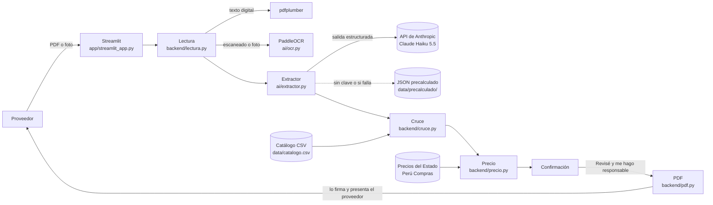

# Cotizador Digital

> **Preparamos cotizaciones listas para firmar para mypes proveedoras del Estado peruano, mediante IA que lee la solicitud de cotización y la cruza con su catálogo de productos.**

Proyecto final de la Diplomatura en Ciencia de Datos (Q-Lab PUCP). Demo de un solo flujo, para bienes: de la solicitud de cotización al PDF listo para firmar.

**Regla de oro:** ningún dato técnico entra a la cotización sin una fuente. Lo que no está verificado se marca en rojo y el PDF no se genera hasta que el proveedor lo revise y confirme. **La herramienta nunca firma ni envía nada.**

---

## 1. One-liner

Preparamos cotizaciones listas para firmar para mypes proveedoras del Estado peruano, mediante IA que lee la solicitud de cotización y la cruza con su catálogo de productos.

## 2. Founder

**Ivette Mamani Flores**: contadora pública y administradora de contratos en el sector público, en Tacna. Conoce el proceso desde el lado de la entidad: cómo se arma una solicitud de cotización, qué se revisa al recibir las propuestas y por qué una cotización incompleta queda fuera. Construye la startup sola, con un agente de IA como co-founder técnico (ver la parte 9).

> ✍️ **Pendiente (Ivette):** en dos o tres líneas, por qué tú y por qué ahora; por ejemplo, qué viste en tu trabajo que te llevó a esta idea.

## 3. Problema

Las unidades de logística de las entidades públicas envían **solicitudes de cotización** a pequeños proveedores para sus contrataciones menores (hasta 8 UIT). Para responder cada una, el proveedor tiene que:

1. leer los términos de referencia o las especificaciones técnicas;
2. ver si su producto cumple, requisito por requisito;
3. buscar la ficha técnica que lo respalde;
4. calcular un precio competitivo;
5. llenar la carta y los anexos.

Todo se hace a mano, con Word y Excel. **Muchas solicitudes quedan sin responder**, y el Estado pierde ofertas de mypes que sí podían cumplir.

> ✍️ **Pendiente (Ivette):** las cifras y una frase textual de tus 3 conversaciones (`docs/research/`): cuántas solicitudes reciben al mes, cuántas quedan sin responder y cuánto tiempo toma cada cotización.

## 4. Solución e insight

**Solución:** una app que en minutos convierte la solicitud en una cotización lista para revisar y firmar.

| Paso | Qué hace | Cómo |
|---|---|---|
| 1. Subir | PDF digital, PDF escaneado o foto | Streamlit |
| 2. Leer | Extrae el texto, página por página | pdfplumber; PaddleOCR si la página es imagen |
| 3. Extraer | Entidad, objeto, ítems, requisitos técnicos (atributo, operador, valor, unidad), plazo, lugar, fecha límite y anexos, **con la cita y la página de cada requisito** | LLM con salida estructurada + Pydantic |
| 4. Cruzar | Cada requisito contra el catálogo del proveedor: ✅ cumple, ⚠️ revisar o ❌ no cumple, con la fuente de cada dato. Ordena los productos por estado, stock y costo | pandas |
| 5. Precio | Costo + flete + margen, comparado con lo que pagó el Estado: mínimo, mediana, máximo y número de órdenes, precio sugerido y semáforo | plotly |
| 6. Confirmar | Cada dato en rojo se confirma uno por uno, más la casilla **"Revisé y me hago responsable"**. Recién entonces se genera el PDF: carta, cuadro de precios y matriz de cumplimiento | fpdf2 |

**Insight:** el cuello de botella no es la falta de producto, sino el **trabajo de verificación**: leer, contrastar y documentar. Por eso la herramienta no "decide" por el proveedor. Hace el trabajo pesado y muestra la fuente de cada dato. Lo que no tiene fuente queda en rojo, y la responsabilidad final (revisar y firmar) sigue siendo del proveedor.

> ✍️ **Pendiente (Ivette):** valida o corrige este insight con lo que escuches en tus conversaciones.

## 5. Why now

- **IA barata y con salida estructurada.** Un modelo económico como Claude Haiku 5.5 cuesta US$ 0,10 por millón de tokens de entrada y US$ 0,50 por millón de salida (tabla de precios de Anthropic, octubre de 2026), y devuelve JSON validado contra un esquema. El costo por cotización se mide con llamadas reales (parte 7).
- **OCR abierto que corre sin tarjeta gráfica.** PaddleOCR lee una página escaneada en unos 6 segundos en una laptop común (medido en este proyecto).
- **Datos abiertos de compras públicas.** Perú Compras publica las órdenes de compra de sus Catálogos Electrónicos, con exportación detallada, y el OECE gestiona los contratos menores en una herramienta digital ([gob.pe: Gestionar Contratos Menores](https://www.gob.pe/70088-gestionar-contratos-menores)).

## 6. Demo

**URL pública:** ✍️ *pendiente: la URL de Streamlit Community Cloud.*

La demo funciona **sin clave de API** (modo demo): usa el resultado precalculado de la solicitud de ejemplo y lo avisa en pantalla. Así la presentación no depende de internet.

### Capturas

| Requisitos extraídos, con la cita de cada uno | Cruce: el dato sin fuente queda en rojo | Confirmación y PDF |
|---|---|---|
|  |  |  |

*Capturas con la solicitud de EJEMPLO SINTÉTICO, el catálogo de ejemplo y un margen y un flete ilustrativos.*

### Arquitectura



### Modelos y APIs, y por qué

| Pieza | Elección | Por qué |
|---|---|---|
| Extracción de requisitos | **Claude Haiku 5.5** (`claude-haiku-5-5`), API de Anthropic, con `messages.parse()` y un esquema Pydantic | Es el modelo vigente más económico (el costo por cotización es parte del modelo de negocio) y la salida estructurada devuelve JSON que siempre cumple el esquema. Se puede cambiar con la variable `ANTHROPIC_MODEL`. |
| OCR | **PaddleOCR**, modelos `PP-OCRv5_mobile_det` y `latin_PP-OCRv5_mobile_rec` | Es abierto, corre en CPU, lee tildes y ñ, y los modelos *mobile* caben en la memoria de un servidor gratuito. Se carga solo cuando hace falta. |
| PDF digital | **pdfplumber** | Si la página trae texto, no hace falta OCR: es instantáneo y exacto. |
| Datos de precios | **Perú Compras**: buscador de órdenes de Catálogos Electrónicos, exportación detallada | Es la fuente oficial de lo que pagó el Estado por bienes similares. |

## 7. Modelo de negocio

| Plan | Precio | Qué incluye |
|---|---|---|
| **Primer proveedor gratis** | S/ 0 | 3 cotizaciones |
| **Básico** | S/ 79 al mes | ✍️ *pendiente* |
| **Pro** | S/ 179 al mes | ✍️ *pendiente* |

> ✍️ **Pendiente (Ivette):** qué incluye cada plan pagado (por ejemplo, cuántas cotizaciones al mes, cuántos productos en el catálogo y si incluye alertas cuando lleguen) y qué responden tus entrevistados sobre la disposición a pagar.

**Costo por usuario:**

| Componente | Costo | Cómo se obtiene |
|---|---|---|
| IA (tokens) | ✍️ *pendiente: US$ por cotización* | Cada llamada al LLM registra sus tokens en `logs/uso_llm.jsonl`; `python -m ai.costos` calcula el costo promedio por cotización. Se mide con las solicitudes reales y la clave de API. |
| OCR | S/ 0 | PaddleOCR corre dentro de la app, sin API de pago. |
| Servidor | S/ 0 en la demo | Streamlit Community Cloud es gratis. Hugging Face Spaces exige hoy la suscripción PRO (US$ 9 al mes) para apps como esta. |
| APIs de datos | S/ 0 | Los datos de Perú Compras son abiertos. |

Costo de IA al mes por usuario = costo por cotización × cotizaciones al mes.

## 8. Herramientas del curso

| Herramienta | Sesión | Dónde está |
|---|---|---|
| Scraping responsable | 03 | **No hizo falta scraping** (regla 1: primero la vía oficial). Antes de consultar Perú Compras se revisó su `robots.txt` (no existe) y se usó su exportación oficial, descargada a mano. Fuentes y reglas en [Datos y fuentes](#datos-y-fuentes). |
| LLM con salida estructurada | 08 | [`ai/extractor.py`](ai/extractor.py), [`ai/esquemas.py`](ai/esquemas.py), [`ai/prompts.py`](ai/prompts.py) |
| OCR | 10 | [`ai/ocr.py`](ai/ocr.py), [`backend/lectura.py`](backend/lectura.py) |
| pandas | | [`backend/catalogo.py`](backend/catalogo.py), [`backend/cruce.py`](backend/cruce.py), [`backend/precios.py`](backend/precios.py) |
| Visualización (plotly) | | [`backend/grafico_precio.py`](backend/grafico_precio.py) |
| App web (Streamlit) | | [`app/streamlit_app.py`](app/streamlit_app.py) |
| Validación (Pydantic) | | [`ai/esquemas.py`](ai/esquemas.py) |
| PDF (fpdf2) | | [`backend/pdf.py`](backend/pdf.py) |
| Pruebas (pytest) | | [`tests/`](tests/): 57 pruebas |
| Evaluación | 12 | Opcional, pendiente: medir qué porcentaje de requisitos se extrae bien en solicitudes revisadas a mano. |

## 9. Qué hizo el agente

El código lo escribió **Claude Code** (Claude Opus 5.5) como co-founder técnico, bloque por bloque, a partir del encargo de Ivette ([`docs/prompt_inicial.md`](docs/prompt_inicial.md)). Ivette aprobó cada bloque antes de pasar al siguiente. El registro completo de qué generó el agente y qué decidió Ivette está en [`docs/agente.md`](docs/agente.md).

En resumen:

- **Generó** todo el código, las 57 pruebas, la solicitud y el catálogo de ejemplo (sintéticos y marcados como tales), los archivos de despliegue y esta documentación.
- **Resolvió en el camino:** el antivirus que interceptaba HTTPS (con `truststore`), un error de paddlepaddle 3.3 con oneDNN (se fijó la versión 3.2.2, cuatro veces más rápida) y el cambio de Hugging Face Spaces a Streamlit Community Cloud cuando HF empezó a cobrar.
- **No inventó** especificaciones de productos reales, márgenes, fletes ni cifras del mercado: esos datos quedan como campos que llena el proveedor o como pendientes marcados con ✍️.
- **Ivette decidió** el problema, el flujo, la regla de oro, los planes, la plataforma de despliegue y qué entra o no en la demo.

---

## Datos y fuentes

| Dato | Fuente | Estado |
|---|---|---|
| Solicitud de cotización | `data/solicitudes/ejemplo_sintetico.*`: **EJEMPLO SINTÉTICO** de una entidad ficticia, en PDF digital, PDF escaneado y foto | ✅ |
| Solicitudes reales | 3 a 5 solicitudes públicas descargadas de portales de entidades, nunca documentos internos | ✍️ pendiente |
| Catálogo | `data/catalogo_ejemplo.csv`: productos ficticios marcados EJEMPLO. El catálogo real va en `data/catalogo.csv`, con la fuente de cada dato | ✍️ pendiente el real |
| Precios del Estado | Buscador de órdenes de compra de Catálogos Electrónicos de Perú Compras ([catalogos.perucompras.gob.pe/ConsultaOrdenesPub](https://catalogos.perucompras.gob.pe/ConsultaOrdenesPub)), exportación detallada descargada a mano | ✍️ pendiente la descarga |

**Reglas que se aplicaron:**

- Primero la vía oficial. No se hizo scraping.
- `robots.txt` revisado: no existe.
- Consultas identificadas con el nombre del proyecto y la URL del repo, con pausas de al menos 3 segundos.
- Las descargas en bruto van a `data/cache/`, que no se sube a GitHub. A `data/` solo pasa la versión limpia: sin nombres, DNI, correos ni teléfonos de personas, y con la URL de origen y la fecha de consulta.
- La "Descarga Masiva" de datos abiertos de Perú Compras se descartó: solo llega hasta noviembre de 2023 y no trae el precio por producto.

## Cómo replicarlo en otra computadora

Cualquier persona puede descargar el proyecto y correrlo. **La clave de API no viene en el código:** cada persona usa la suya, y el consumo se cobra a su cuenta. Sin clave, la app funciona en modo demo.

**Necesitas:**

- **Python 3.11** ([python.org/downloads](https://www.python.org/downloads/)). En Windows, marca *"Add python.exe to PATH"* al instalarlo.
- **Internet la primera vez**, para instalar las librerías y descargar los modelos del OCR (unos cientos de MB).
- *(Opcional)* Una clave de API de Anthropic ([platform.claude.com](https://platform.claude.com)).

**Windows:** descarga el proyecto (*Code → Download ZIP*) en una **carpeta corta**, por ejemplo `C:\Cotizador`, y haz doble clic en **`iniciar.bat`**. La primera vez instala todo, lo que tarda varios minutos. Después abre la app en el navegador. Para usar la IA, pega tu clave en el archivo `.env` y vuelve a abrir `iniciar.bat`.

**macOS / Linux:**

```bash
git clone https://github.com/IvettexMamani/Cotizador_digital.git
cd Cotizador_digital
python3.11 -m venv .venv && source .venv/bin/activate
pip install -r requirements.txt
cp .env.example .env        # opcional: pega tu clave en .env
streamlit run app/streamlit_app.py
```

**Problemas frecuentes:**

- **`OSError` o `No such file or directory` al instalar en Windows:** la carpeta está demasiado "profunda" (Windows limita las rutas a 260 caracteres). Mueve el proyecto a una carpeta corta, borra `.venv` y vuelve a abrir `iniciar.bat`.
- **`CERTIFICATE_VERIFY_FAILED`:** algunos antivirus, como Avast, inspeccionan las conexiones seguras. `iniciar.bat` reintenta la instalación con los certificados de Windows, y la app ya trae la corrección (`truststore`).
- **"No hay resultado precalculado":** estás en modo demo con un documento nuevo. Usa la solicitud de ejemplo o agrega tu clave.

**Comandos útiles:**

```bash
pytest                         # las 57 pruebas (pytest -m "not lento" omite las de OCR)
python -m ai.precalcular data/solicitudes/mi_solicitud.pdf   # guarda un resultado para el modo demo (requiere clave)
python -m ai.costos            # costo promedio de IA por cotización
```

## Estructura

```
app/        aplicación Streamlit (los 6 pasos)
backend/    lectura, catálogo, cruce, precio, precios del Estado, gráfico y PDF
ai/         esquemas Pydantic, prompts, extractor LLM, OCR y costos
data/       solicitud y catálogo de ejemplo, resultados precalculados (sin datos personales)
docs/       diagrama, capturas, research/, agente.md, guion del video y del pitch
tests/      pruebas de lectura, extracción, cruce, precio, PDF y app
despliegue/ plan B: Dockerfile para Hugging Face Spaces
```

## Qué sigue (fuera de la demo)

- Buscador de oportunidades: encontrar solicitudes de cotización publicadas.
- Alertas por WhatsApp cuando llegue una solicitud que el proveedor puede atender.
- Lectura del correo, donde llegan las solicitudes.
- Verificación de RUC y RNP del proveedor.
- Cotizaciones de servicios, no solo de bienes.

## Licencia

[MIT](LICENSE) · Ivette Mamani Flores, 2026
