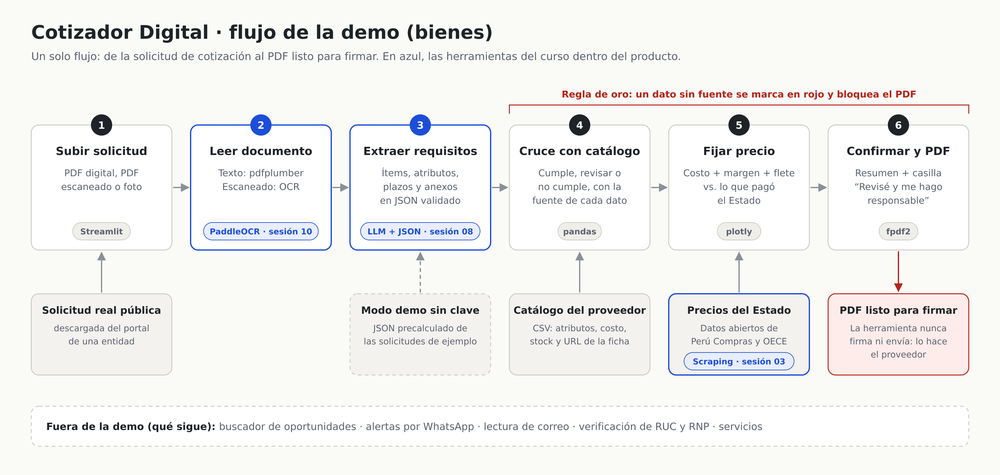

# Cotizador Digital

> Preparamos cotizaciones listas para firmar para mypes proveedoras del Estado peruano, mediante IA que lee la solicitud de cotización y la cruza con su catálogo de productos.

**Estado:** en construcción. Funcionan los pasos 1 a 3 (subir, leer y extraer requisitos). Este README se completa en el Bloque 5.

## Regla de oro

Ningún dato técnico entra a la cotización sin una fuente. Lo que no está verificado se marca en rojo y el PDF no se genera hasta que el proveedor lo revise y confirme. **La herramienta nunca firma ni envía nada.**

## Flujo de la demo (solo bienes)



1. **Subir la solicitud de cotización:** PDF digital, PDF escaneado o foto.
2. **Leerla:** pdfplumber para texto; PaddleOCR para escaneados e imágenes.
3. **Extraer requisitos** con un LLM de salida estructurada, validados con Pydantic.
4. **Cruzar con el catálogo** del proveedor: cumple / revisar / no cumple, con la fuente de cada dato.
5. **Fijar precio:** costo + margen + flete, comparado con lo que pagó el Estado (datos abiertos).
6. **Confirmar y generar el PDF**, listo para imprimir y firmar.

## Cómo replicarlo en otra computadora

Cualquier persona puede descargar el proyecto y correrlo en su computadora. **La clave de API no viene en el código:** cada persona usa la suya, y el consumo se cobra a su cuenta. Sin clave, la app funciona en modo demo con las solicitudes de ejemplo.

**Necesitas:**

- **Python 3.11** ([python.org/downloads](https://www.python.org/downloads/)). En Windows, marca la casilla *"Add python.exe to PATH"* al instalarlo.
- **Internet la primera vez**, para instalar las librerías y descargar los modelos del OCR (unos cientos de MB).
- **Opcional:** una clave de API de Anthropic, creada en [platform.claude.com](https://platform.claude.com), para que la IA lea solicitudes nuevas.

### Windows (doble clic)

1. Descarga el proyecto: en GitHub, botón **Code → Download ZIP**, y descomprímelo. También puedes usar `git clone https://github.com/IvettexMamani/Cotizador_digital.git`.
2. Abre la carpeta y haz **doble clic en `iniciar.bat`**. La primera vez instala todo, lo que tarda varios minutos. Luego se abre la app en el navegador.
3. *(Opcional)* Para usar la IA: abre el archivo `.env` con el Bloc de notas, pega tu clave después de `ANTHROPIC_API_KEY=`, guarda y vuelve a abrir `iniciar.bat`.

### macOS / Linux (terminal)

```bash
git clone https://github.com/IvettexMamani/Cotizador_digital.git
cd Cotizador_digital
python3.11 -m venv .venv
source .venv/bin/activate
pip install -r requirements.txt
cp .env.example .env        # opcional: pega tu clave en .env
streamlit run app/streamlit_app.py
```

### Problemas frecuentes

- **`CERTIFICATE_VERIFY_FAILED` o "invalid peer certificate" al instalar:** algunos antivirus (por ejemplo, Avast) inspeccionan las conexiones seguras. Instala con `pip install --use-feature=truststore -r requirements.txt`, o desactiva un momento el "escudo web" del antivirus. La app ya trae la corrección para cuando está funcionando (`truststore`).
- **La primera lectura con OCR tarda más:** ese momento carga, y si hace falta descarga, los modelos de PaddleOCR. Las siguientes lecturas tardan unos segundos por página.
- **"No hay resultado precalculado":** estás en modo demo con un documento nuevo. Usa una solicitud de ejemplo o agrega tu clave en `.env`.

**Modo demo sin clave:** si no hay `ANTHROPIC_API_KEY` o la API falla, la app usa los resultados guardados en `data/precalculado/` para las solicitudes de ejemplo y lo avisa en pantalla. Así la demo no depende de internet. Para guardar el resultado de una solicitud nueva (requiere clave):

```bash
python -m ai.precalcular data/solicitudes/mi_solicitud.pdf
```

**Pruebas:** `pytest` (todas) o `pytest -m "not lento"` (sin las de OCR).

## Estructura

```
app/        aplicación Streamlit
backend/    lectura, cruce, precios, PDF
ai/         prompts, esquemas Pydantic, extractor LLM, OCR
data/       muestras chicas, sin datos personales
docs/       diagrama, capturas, research/ y agente.md
notebooks/  exploración de precios
tests/      pruebas del cruce y del cálculo de precio
```

## Qué sigue (fuera de la demo)

- Buscador de oportunidades
- Alertas por WhatsApp
- Lectura de correo
- Verificación de RUC y RNP
- Cotizaciones de servicios

## Licencia

[MIT](LICENSE)
